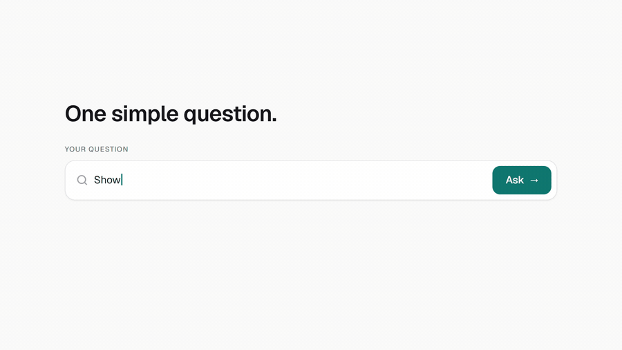
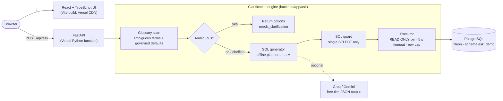
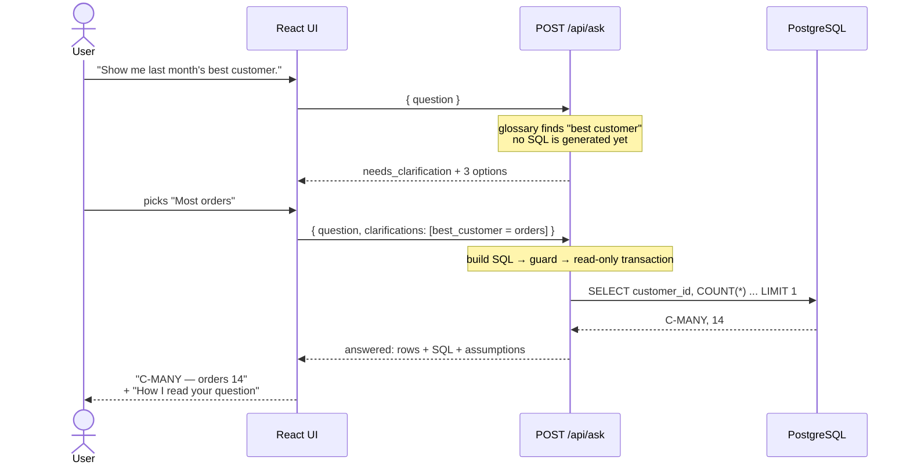
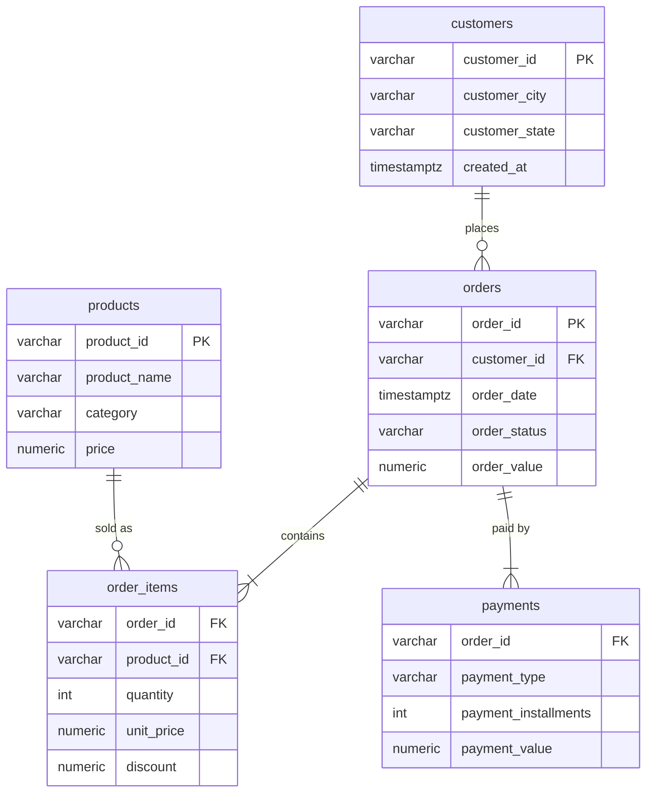

# Text-to-SQL-Engine


**Text-to-SQL that asks what you mean before it answers.**

[](https://ask-your-data-sigma.vercel.app/)


**▶ Try it: <https://ask-your-data-sigma.vercel.app/>** — click *"Show me last month's best customer."*

[](https://ask-your-data-sigma.vercel.app/)

---

## The problem

A company keeps its customers, orders and payments in a database. Getting answers out of it normally means
writing SQL. A text-to-SQL layer lets anyone ask in plain English instead:

> *"How many new customers signed up last month?"*

That part is easy. The real problem is that many business questions are **incomplete**:

> *"Show me last month's best customer."*

What does *best* mean?

| Reading | Answer on the demo data |
|---|---|
| The customer who **spent the most** | **C-WHALE** — R$ 18,295 in one order |
| The customer who **placed the most orders** | **C-MANY** — 14 orders |
| The customer who **came back most often** | **C-FREQ** — orders on 10 different days |

Three reasonable readings, three different customers. A typical text-to-SQL system picks one silently,
generates one query, and **confidently returns the wrong answer** for two out of three people asking. The
user has no way to tell it guessed.

A careful analyst would ask first: *"Do you mean highest spend, or most orders?"* — and only then write the
query. That is what this project does, and it measures how much it matters.

## What it does

1. **Detects** when a question has more than one reasonable meaning that changes the result.
2. **Asks** the user which meaning they intend, with plain-language options — *before* any SQL runs.
3. **Generates** read-only PostgreSQL for the chosen meaning and runs it safely.
4. **Shows** the answer together with every assumption it made, and the SQL on request.
5. **Measures** accuracy with and without the clarification step on a labelled test set.

## Results

30 labelled questions (16 clear, 14 ambiguous), each with hand-written gold SQL. A run is correct when its
result matches the gold result.

| | Without clarification | With clarification engine |
|---|---|---|
| **All questions** | 21/30 (70%) | **30/30 (100%)** |
| Ambiguous questions | 5/14 (36%) | **14/14 (100%)** |
| Clear questions | 16/16 (100%) | 16/16 (100%) |

| Clarification behaviour | |
|---|---|
| Asked on ambiguous questions (recall) | 14/14 |
| Asked on clear questions (over-asking) | **0/16** |
| Questions asked per ambiguous question | 1.0 |

- The same ambiguous question appears several times with **different intended meanings**
  (e.g. "best customer" meant as spend, as orders, as visits). A system that guesses can be right for at most
  one of them; asking is right for all.
- Every ambiguous case passes a **discrimination check**: the other readings really return different results,
  so no case is "ambiguous" only on paper.
- Clarifying never hurt clear questions (16/16 both ways) — the engine does not over-ask.

> **Honest caveat.** These numbers use the offline generator, where both arms share the same rule-based SQL
> planner. They isolate the effect of *asking vs. guessing*, not language understanding. The same harness runs
> against an LLM with `python scripts/eval_ask.py --provider groq`.

Full per-question report: [docs/eval-results.md](docs/eval-results.md).

## Architecture



### Request flow



The API is **stateless**: the second request simply repeats the question with the chosen options, so there is
no session store and nothing to expire.

## How the clarification engine works

### 1. A business glossary (the semantic layer)

Ambiguity is defined in a reviewed glossary, not left to chance. This mirrors how real data teams govern
metric definitions (dbt metrics, Cube, LookML).

| Term | Triggered by | Options the user chooses from |
|---|---|---|
| `best_customer` | best / top / number one / most valuable customer | highest spend · most orders · came back most often |
| `best_product` | best / top / best-selling / most popular product | most revenue · most units sold |
| `best_category` | best / top category, "category performed best" | most revenue · most units sold |
| `new_customers` | "new customers" | signed up in the period · first purchase in the period |
| `recent` | recent, recently, lately (no explicit period) | last 7 · 30 · 90 days |
| `large_order` | big / large / high-value orders | value over 1,000 · top 10% by value |
| `active_customers` | "active customers" (no explicit period) | ordered in last 30 · 90 · 365 days |

It **doesn't ask** when the question already settles the meaning:
*"Top 5 customers **by total spend**"*, *"new customers who **signed up**"*, *"active customers **last month**"*.

### 2. Governed defaults — applied, not asked

Asking about everything would make the tool unusable. Terms with one company-approved meaning are applied
and listed in the answer under *"How I read your question"*:

- Revenue = sum of order value for non-canceled orders.
- Canceled orders are excluded unless the question is about cancellations.
- "Last month" = previous calendar month; "last N days" = the N full days before today.
- No period mentioned = all time.

### 3. SQL generation — two generators, one interface

| Generator | When | How |
|---|---|---|
| **Offline planner** (default) | Always available, no network, ₹0 | Intent + period parsing → SQL templates |
| **LLM** (optional) | `ASK_LLM_PROVIDER=groq` or `gemini` | Schema + metric rules + the user's chosen definitions in the prompt; JSON output validated by **Pydantic**, one automatic repair retry |

In LLM mode the model can also flag ambiguities the glossary doesn't know about; they are shown to the user
the same way.

### 4. Safety

- **SQL guard:** exactly one `SELECT` / `WITH` statement; no comments, no semicolons, no write or admin keywords.
- **Executor:** every query runs inside `SET TRANSACTION READ ONLY`, with a 5-second `statement_timeout`, a
  row cap and a fixed `search_path`, and is always rolled back. The guard gives clear errors; the read-only
  transaction is the real control.

## Evaluation method

- **Test set:** [`eval/cases.json`](eval/cases.json) — 30 questions. Each has a hand-written gold SQL query
  and, for ambiguous ones, the **intended meaning** a real user would choose.
- **Two arms**
  - `direct` — clarification off: the generator resolves ambiguity by guessing.
  - `engine` — clarification on: a **simulated user** answers the engine's question with the intended meaning,
    then the question is re-sent.
- **Correctness = execution match:** same row count, and every gold column's values appear in the generated
  result (order-independent, numbers rounded to 2 decimals). Extra columns are allowed.
- **Fair baseline:** both arms use the same glossary defaults and the same generator; the only difference is
  whether the system asks.

Run it: `python scripts/eval_ask.py` → rewrites [docs/eval-results.md](docs/eval-results.md).

## Data model

Demo store data (deterministic seed; 403 customers, 1,032 orders, 32 products; September 2026 is "last month"):



The seed plants three September customers — C-WHALE, C-MANY and C-FREQ — so that "best customer" genuinely
has three different answers.

## API

```http
POST /api/ask
Content-Type: application/json

{ "question": "Show me last month's best customer." }
```

```json
{
  "status": "needs_clarification",
  "clarifications": [{
    "term": "best_customer",
    "prompt": "What does 'best customer' mean here?",
    "options": [
      { "id": "revenue",   "label": "Highest spend",        "definition": "..." },
      { "id": "orders",    "label": "Most orders",          "definition": "..." },
      { "id": "frequency", "label": "Came back most often", "definition": "..." }
    ]
  }]
}
```

Send the same question with the choice:

```json
{ "question": "Show me last month's best customer.",
  "clarifications": [{ "term": "best_customer", "option_id": "orders" }] }
```

```json
{
  "status": "answered",
  "sql": "SELECT o.customer_id, COUNT(*) AS orders FROM orders o WHERE ... LIMIT 1",
  "columns": ["customer_id", "orders"],
  "rows": [["C-MANY", 14]],
  "assumptions": [
    "best_customer: Most orders — Customer who placed the most non-canceled orders (your choice)",
    "Period: previous calendar month (2026-09-01 to 2026-09-30)",
    "Canceled orders are excluded."
  ]
}
```

`status` is one of `needs_clarification · answered · unsupported · rejected · error`. `"mode": "direct"`
turns clarification off (the baseline), and `GET /api/health` is a database-free liveness check.

## Tech stack

| Layer | Choice | Why |
|---|---|---|
| API | **FastAPI** + **Pydantic** | Typed request/response models; Pydantic also validates LLM JSON |
| Database | **PostgreSQL** (Neon free tier) + **SQLAlchemy** / psycopg | Real SQL dialect; read-only transactions and timeouts |
| SQL generation | Rule-based planner · **Groq / Gemini** free tier (optional) | Works offline at ₹0; LLM for open-ended questions |
| Frontend | **React**, TypeScript, Tailwind CSS, Vite | Clarification tiles, results table, assumptions, SQL disclosure |
| Hosting | **Vercel** (Services: static site + Python function) | One project, one domain, no server to manage |
| Tests | **pytest** (88 unit + 1 Postgres integration) | Guard, periods, glossary, planner, engine, LLM clients (mocked), API |

**Cost: ₹0** — free tiers only; no paid API is required.

## Project structure

```text
ask-your-data/
├── backend/
│   ├── app/
│   │   ├── main.py           FastAPI app: /api/ask, /api/health
│   │   ├── api/ask.py        request handler
│   │   └── ask/
│   │       ├── glossary.py   ambiguous terms + governed defaults + detection
│   │       ├── periods.py    "last month" → date range
│   │       ├── planner.py    offline SQL generator
│   │       ├── llm.py        Groq / Gemini clients, structured output + retry
│   │       ├── engine.py     detect → clarify → generate → guard → execute
│   │       ├── sql_guard.py  single read-only statement check
│   │       ├── executor.py   read-only transaction, timeout, row cap
│   │       ├── schemas.py    Pydantic models (API + LLM outputs)
│   │       └── config.py     settings from env
│   ├── tests/test_ask.py
│   └── requirements.txt
├── frontend/                 React UI (src/pages/Ask.tsx)
├── scripts/
│   ├── seed_ask_demo.py      deterministic demo data
│   └── eval_ask.py           with vs without clarification evaluation
├── eval/cases.json           30 labelled questions + gold SQL
├── sql/schema.sql            demo schema
├── docs/                     PRD, build plan, design system, eval results
└── vercel.json               frontend + API services
```

## Run locally

Requires Python 3.12+, Node 20+ and Docker.

```bash
git clone https://github.com/Girisha1908/ask-your-data.git
cd ask-your-data
docker compose up -d                      # Postgres on localhost:5433
cp .env.example .env

python -m venv .venv
.venv\Scripts\activate                    # macOS/Linux: source .venv/bin/activate
pip install -r requirements-dev.txt
python scripts/seed_ask_demo.py           # load demo data
uvicorn app.main:app --app-dir backend --port 8001
```

In a second terminal:

```bash
cd frontend
npm install
npm run dev                               # http://localhost:5173  (proxies /api to :8001)
```

### Tests and evaluation

```bash
pytest                                       # unit tests, no database needed
python scripts/eval_ask.py                   # accuracy with vs without clarification
python scripts/eval_ask.py --provider groq   # same, with an LLM (needs GROQ_API_KEY)
```

Set `ASK_TEST_DATABASE_URL` to also run the Postgres integration test (it reseeds that database).

## Deployment

One Vercel project serves both halves ([`vercel.json`](vercel.json), Vercel Services): `/api/*` goes to the
FastAPI function in `backend/`, everything else to the Vite build in `frontend/`. Data lives in Neon Postgres.

| Environment variable | Value |
|---|---|
| `DATABASE_URL` | Neon connection string (pooled) |
| `ASK_AS_OF_DATE` | `2026-10-13` — the demo data's "today", so "last month" stays September 2026 |
| `ASK_LLM_PROVIDER` | `offline` (or `groq` / `gemini` plus `GROQ_API_KEY` / `GEMINI_API_KEY`) |

Seed the hosted database once with `DATABASE_URL=<neon url> python scripts/seed_ask_demo.py`.
`/api/health` never touches the database, so an uptime monitor can poll it without keeping Neon awake.

## Limitations and next steps

- The offline planner covers common question shapes (counts, revenue, AOV, rankings, breakdowns by month,
  category, state and payment method); other questions return `unsupported` unless an LLM is configured.
- The glossary is hand-curated: seven terms today. A new business term needs a new entry.
- One clarification round per question; choices are not remembered across questions.
- Demo data only, in a fixed five-table schema.
- Next: publish LLM-mode results, remember a user's preferred definitions, and use a dedicated read-only
  database role for multi-user deployments.

## Documentation

- [Product requirements (PRD)](docs/PRD.md) — problem, scope, API contract, design decisions, risks
- [Build plan](docs/PLAN.md) — phases and tickets
- [Design system](docs/DESIGN.md) — UI colours, type, components
- [Evaluation results](docs/eval-results.md) — per-question outcomes

## License

MIT © Anamala Girisha
